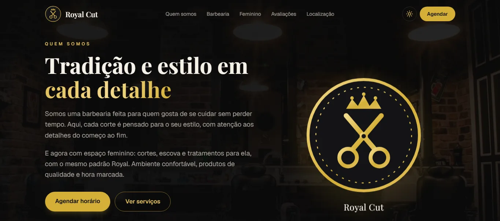

# Royal Cut · Barbearia e espaço feminino

Site de uma barbearia com espaço feminino e **agendamento online de verdade**: o cliente escolhe o serviço, o dia e um horário livre, e o profissional acompanha tudo numa agenda própria.

**Site no ar: [site-barbearia-royal-cut.vercel.app](https://site-barbearia-royal-cut.vercel.app)**

[](https://site-barbearia-royal-cut.vercel.app)

> Projeto de portfólio. A barbearia, o endereço, as fotos (Unsplash) e as avaliações são de exemplo.

## O que o site faz

**Para o cliente**

- Página com apresentação, serviços da barbearia com fotos e preços, cardápio do espaço feminino, avaliações em carrossel e localização com mapa
- Agendamento em 5 passos: serviço → dia → horário → nome e celular → confirmação
- Só aparecem horários em que o serviço inteiro cabe: respeita a duração de cada serviço, o almoço, o fim do expediente e os horários já ocupados
- Tema preto e dourado com modo claro, animações ao rolar a página e layout pensado para o celular

**Para o profissional** (página `/agenda`)

- Agendamentos do dia com cliente, serviço, valor e situação (confirmado, concluído ou cancelado)
- Busca por nome ou celular do cliente
- Botão de WhatsApp com a mensagem pronta, e botões para concluir, cancelar ou reabrir
- Resumo do dia (agendados, concluídos e valor previsto) e atualização automática a cada minuto
- Protegida por senha no site publicado

## Como o agendamento evita conflitos

As regras importantes ficam no próprio banco de dados (PostgreSQL), não só na tela:

- Uma _exclusion constraint_ (`sem_horario_duplicado`) recusa dois agendamentos do mesmo profissional com horários sobrepostos, mesmo quando duas pessoas confirmam no mesmo segundo. Quem chega depois recebe "esse horário acabou de ser preenchido".
- Agendamentos cancelados não contam, então o horário volta a ficar livre.
- O preço é copiado para o agendamento no momento da marcação, então mudar a tabela de preços não altera o que já foi agendado.
- O cliente é reconhecido pelo celular (único), sem cadastro nem senha.

## Tecnologias

- [Next.js](https://nextjs.org) 16 (App Router) e React 19
- TypeScript
- Tailwind CSS 4
- [Prisma](https://www.prisma.io) 7 com PostgreSQL no [Supabase](https://supabase.com)

## Estrutura

```
banco/                 SQL para criar as tabelas e os dados de exemplo
prisma/schema.prisma   espelho das tabelas para o Prisma
src/app/               páginas (/ e /agenda) e rotas da API
src/components/        partes da página (topo, serviços, avaliações, agendamento…)
src/lib/agenda.ts      regras do agendamento e consulta de horários livres
src/lib/conteudo.ts    textos, fotos, endereço e avaliações do site
```

Para adaptar o site a outro estabelecimento, quase tudo se troca em `src/lib/conteudo.ts`. Serviços, preços e horários de trabalho ficam no banco.

## Como rodar no seu computador

Você vai precisar do [Node.js](https://nodejs.org) 20 ou mais novo e de uma conta gratuita no Supabase.

1. Clone o repositório e instale as dependências:

   ```bash
   git clone https://github.com/LeonardoFabretti/site-barbearia-royal-cut.git
   cd site-barbearia-royal-cut
   npm install
   ```

2. Crie um projeto no Supabase. No **SQL Editor**, rode `banco/estrutura.sql` e depois `banco/dados-exemplo.sql`.

3. Copie `.env.example` para `.env` e preencha com os endereços do seu banco (no Supabase: botão **Connect** → **ORM** → **Prisma**).

4. Inicie o site:

   ```bash
   npm run dev
   ```

   O terminal mostra o endereço local para abrir no navegador. A agenda do profissional fica em `/agenda`.

## Publicando

O site está publicado na [Vercel](https://vercel.com), que atualiza sozinha a cada envio para o ramo `main`. Para publicar a sua cópia: importe o repositório e cadastre as variáveis do `.env.example` (`DATABASE_URL`, `DIRECT_URL` e `AGENDA_SENHA`) nas configurações do projeto. Sem a `AGENDA_SENHA`, a agenda fica fechada no site publicado, para não expor os dados dos clientes.
